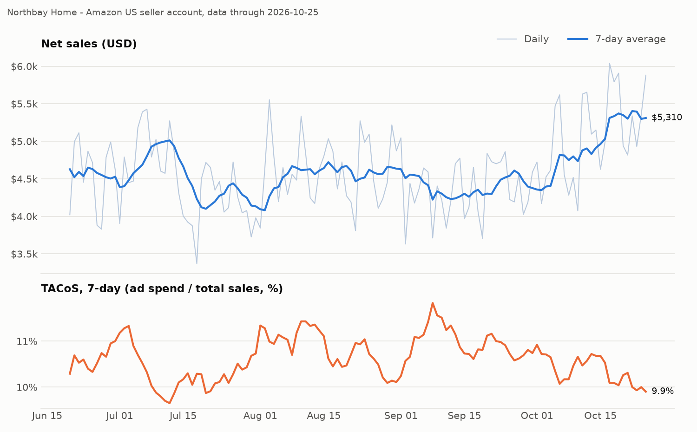
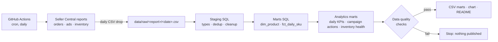

# Amazon Seller Analytics Pipeline


A daily ELT pipeline for an Amazon FBA seller account. It lands the three reports a seller pulls from Seller Central every morning (orders, Sponsored Products ads, FBA inventory), cleans them, models them into a small star schema in DuckDB, tests the data, and answers the questions a seller actually asks:

- **Are sales up or down this week, and how much of it is bought with ads?** (ACoS vs TACoS)
- **Which ad campaigns lose money on every sale?** (ACoS compared with each product's break-even ACoS)
- **Which SKUs will stock out before the next shipment arrives, and what have stockouts already cost?**

GitHub Actions runs the whole thing every morning, commits the new data, and refreshes the KPI block and chart below.

## Today's numbers

<!-- KPI:START -->
**Data through 2026-10-25** · last pipeline run 2026-10-26 19:59 UTC

| Last 7 days | Value |
|---|---|
| Net sales | $37,173 (-0.5% vs prior 7 days) |
| Orders | 1,109 |
| ACoS (ad spend / ad sales) | 32.1% |
| TACoS (ad spend / total sales) | 9.9% |
| Contribution margin after ads | 32.5% |

**Inventory alerts**

| SKU | Product | On hand | Days of cover | Days until restock | Status |
|---|---|---|---|---|---|
| NBH-HM-002 | Under-Bed Storage Bags (3 pk) | 47 | 4.0 | 7 | Stockout risk |
| NBH-PT-001 | Dog Lick Mat (2 pk) | 236 | 7.5 | 17 | Stockout risk |
| NBH-PT-002 | Cat Window Perch | 108 | 12.5 | 15 | Stockout risk |

**Campaigns losing money (last 30 days)** · 8 campaign(s) flagged to scale up

| Campaign | ACoS | Break-even ACoS | Ad profit | Action |
|---|---|---|---|---|
| SP / NBH-KT-002 / Phrase | 70.2% | 41.0% | $-324 | Cut bids: losing money |
| SP / NBH-KT-001 / Phrase | 67.8% | 43.2% | $-305 | Cut bids: losing money |
| SP / NBH-PT-003 / Phrase | 57.7% | 47.1% | $-159 | Cut bids: losing money |
| SP / NBH-HM-003 / Phrase | 45.1% | 41.8% | $-47 | Cut bids: losing money |
| SP / NBH-OF-001 / Auto | 42.6% | 39.0% | $-44 | Cut bids: losing money |
<!-- KPI:END -->



## Architecture



| Layer | Model | Grain | Purpose |
|---|---|---|---|
| Staging | `stg_orders` | order line | Text prices to numeric, uppercase ASINs, remove duplicate export rows |
| Staging | `stg_ads` | campaign × day | Rename report columns, parse targeting type |
| Staging | `stg_inventory` | SKU × day | End-of-day fulfillable and inbound stock |
| Mart | `dim_product` | SKU | Unit economics: COGS, FBA fee, referral fee, break-even ACoS |
| Mart | `fct_daily_sku` | SKU × day | Sales, ads, inventory and contribution profit on one row |
| Mart | `mart_daily_kpis` | day | Net sales, ACoS, TACoS, margin, 7-day rolling metrics |
| Mart | `mart_campaign_actions` | campaign (last 30 days) | Scale / Hold / Cut bids recommendation |
| Mart | `mart_inventory_health` | SKU (latest) | Days of cover, restock timing, stockout risk, estimated lost revenue |

## Key metric definitions

- **ACoS** = ad spend ÷ ad-attributed sales. Measures how efficient the ads are.
- **TACoS** = ad spend ÷ total sales. Measures how dependent the business is on ads. A rising TACoS with flat sales means ads are replacing organic sales instead of adding to them.
- **Break-even ACoS** = (price − unit cost − FBA fee − referral fee) ÷ price. Above this, every ad-driven sale loses money.
- **Days of cover** = fulfillable units ÷ average daily units sold on in-stock days (last 28 days). Out-of-stock days are excluded so demand is not understated.

## Data quality

`src/quality_checks.py` runs dbt-style tests after every build. Each test is a SQL query that returns failing rows. Error-level failures stop the run before anything is published; warnings go to `data/run_log.csv`.

Checks include primary-key uniqueness after dedup, null keys, referential integrity to `dim_product`, non-negative spend and stock, clicks ≤ impressions, one inventory row per SKU per day, source freshness, and a day-over-week sales anomaly check.

## About the data

The data is **simulated**, because real seller data is private. The generator (`src/generate_data.py`) is built to behave like a real account rather than random noise:

- Report layouts follow Seller Central conventions: hyphenated headers, prices stored as text like `$19.99`, occasional duplicate rows and lowercase ASINs that staging has to clean.
- It is stateful. Each day starts from the previous day's inventory, sales cannot exceed stock, ads stop serving when a SKU is out of stock, and purchase orders are placed at a reorder point with random supplier delays.
- Demand follows day-of-week patterns and a Q4 ramp, and some ad campaigns are deliberately inefficient.
- Every day is seeded from its date, so the history is reproducible.

## Run it locally

```bash
pip install -r requirements.txt
python src/generate_data.py      # fills any missing days up to yesterday (UTC)
python src/pipeline.py           # builds models, runs checks, publishes marts and chart
```

The first `generate_data.py` run backfills from 2026-06-14. To regenerate a range: `python src/generate_data.py --start 2026-06-14 --end 2026-10-11`.

## Production mapping

DuckDB keeps this project free to run. The same design maps directly onto an AWS stack:

| Here | On AWS |
|---|---|
| `data/raw/<report>/<date>.csv` | S3 landing bucket partitioned by report and date |
| DuckDB SQL models | Redshift (or Glue / Athena) with dbt |
| `quality_checks.py` | dbt tests or Glue Data Quality |
| GitHub Actions cron | Airflow / MWAA or EventBridge + Step Functions |
| `dashboard.png` + README | QuickSight dashboard |
| Simulated reports | Selling Partner API and Amazon Ads API |

## Project structure

```
├── .github/workflows/daily-pipeline.yml   # scheduled run + auto-commit
├── data/
│   ├── raw/{orders,ads,inventory}/        # daily landing files
│   ├── marts/                             # published model outputs
│   └── run_log.csv                        # one row per pipeline run
├── reports/dashboard.png
├── sql/
│   ├── staging/                           # 01_stg_orders.sql ...
│   └── marts/                             # 01_dim_product.sql ...
└── src/
    ├── catalog.py                         # products and fee assumptions
    ├── generate_data.py                   # daily report simulator
    ├── pipeline.py                        # build → test → publish
    └── quality_checks.py                  # data tests
```

## Author

Jing (Ashley) You · Data Engineer / Analytics Engineer · [GitHub](https://github.com/Ashleysdata)

Before data engineering I ran an e-commerce agency that helped nearly 200 Asian brands launch on Amazon US, so the metrics here are the ones I used to report to clients.
